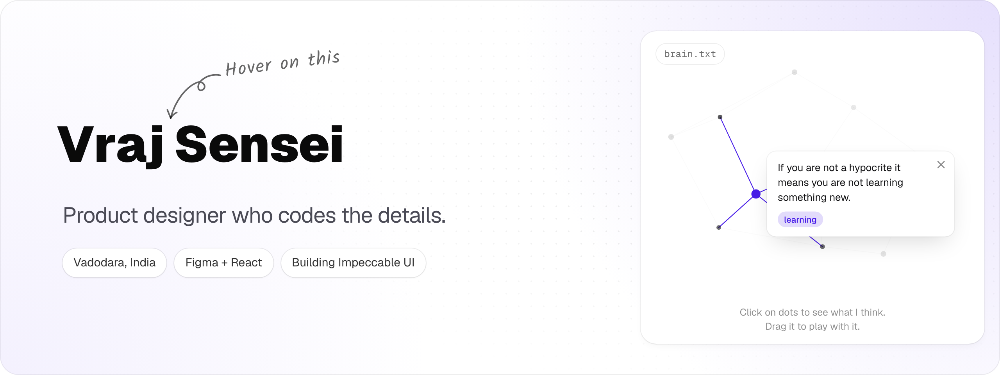
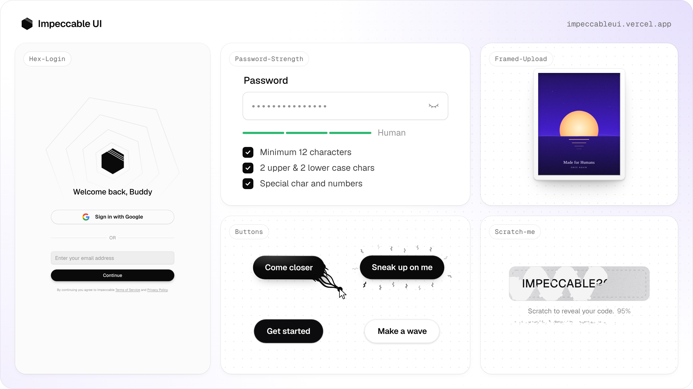
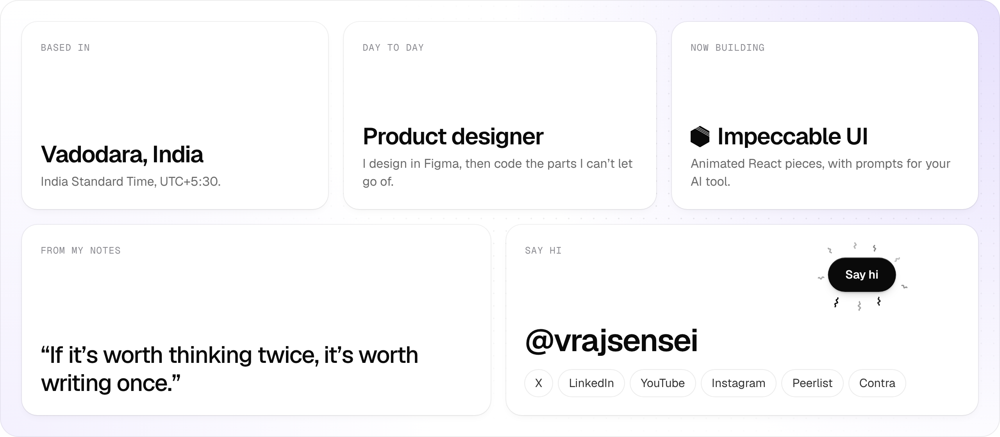

### Hi, I'm Vraj.

I'm a product designer from Vadodara, India, known online as **Vraj Sensei**. I design in Figma, then code the parts I can't let go of: the timing of a motion, the weight of a shadow, the way a button answers when you come close.

### See what I build

**[Impeccable UI](https://impeccableui.vercel.app)** is my free, open-source library of animated React components, buttons, page sections, animations and AI skills. Every piece ships with its code and two prompts for your AI tool: **Install** adds it exactly as you see it, and **Blend** fits it to your brand first.

[Browse the library](https://impeccableui.vercel.app/docs) · [Source on GitHub](https://github.com/prVraj/Impeccable)

### Other stuff about me

[X](https://x.com/vrajsensei) · [LinkedIn](https://www.linkedin.com/in/vraj-parikh-b64b61257/) · [YouTube](https://www.youtube.com/@SenseiVraj) · [Instagram](https://www.instagram.com/vraj_sensei106/) · [Peerlist](https://peerlist.io/vrajsensei) · [Contra](https://contra.com/vraj_sensei_r8it0oe9)
